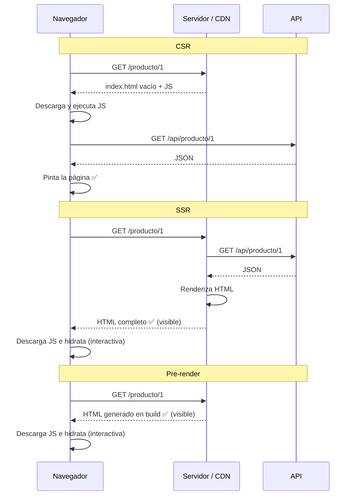
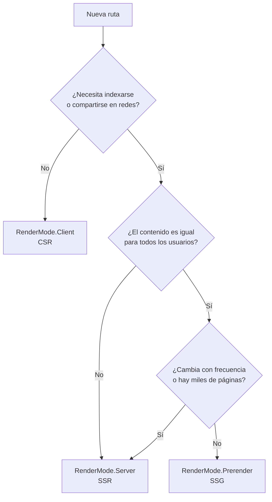

# Estrategias de renderizado en Angular: CSR, SSR y Pre-render

> Guía de referencia para el equipo. Explica qué es cada estrategia, cómo afecta al SEO y al rendimiento, y cómo se implementa en Angular moderno.

---

## Tabla de contenido

1. [Conceptos básicos](#1-conceptos-básicos)
2. [Comparativa general](#2-comparativa-general)
3. [Impacto en SEO](#3-impacto-en-seo)
4. [Rendimiento y experiencia de usuario](#4-rendimiento-y-experiencia-de-usuario)
5. [Implementación en Angular](#5-implementación-en-angular)
6. [Errores frecuentes y soluciones](#6-errores-frecuentes-y-soluciones)
7. [Cómo elegir: árbol de decisión](#7-cómo-elegir-árbol-de-decisión)
8. [Checklist para PRs con SSR](#8-checklist-para-prs-con-ssr)
9. [Glosario](#9-glosario)

---

## 1. Conceptos básicos

La pregunta clave es: **¿dónde y cuándo se genera el HTML que ve el usuario?**

| Estrategia | ¿Dónde? | ¿Cuándo? | Analogía |
|---|---|---|---|
| **CSR** — Client-Side Rendering | Navegador | En cada visita, después de descargar el JS | Te entregan los ingredientes y cocinas tú en casa |
| **SSR** — Server-Side Rendering | Servidor (Node) | En cada request | El restaurante cocina el plato cuando lo pides |
| **Pre-render / SSG** — Static Site Generation | Máquina de build | Una sola vez, en `ng build` | Comida preparada y empacada lista en la nevera |

### Flujo de cada estrategia



---

## 2. Comparativa general

| | **CSR** | **SSR** | **Pre-render** |
|---|---|---|---|
| ✅ **Ventajas** | Infraestructura simple y barata. Navegación interna muy fluida. Sin carga de render en servidor. | Contenido visible rápido. Buen SEO. Datos siempre frescos y personalizables por request. | Lo más rápido posible (CDN). SEO óptimo. Costo de servidor casi nulo. |
| ❌ **Desventajas** | Pantalla en blanco inicial. SEO débil. Sufre en móviles lentos. | Requiere servidor Node. TTFB más alto. Código que corre en dos entornos. Riesgo de *hydration mismatch*. | Contenido congelado hasta el siguiente build. No sirve para contenido por usuario ni para miles de páginas cambiantes. |
| 🎯 **Casos de uso** | Dashboards, backoffice, apps detrás de login. | E-commerce con stock/precios variables, noticias, páginas públicas dinámicas. | Landings, blogs, documentación, páginas de marketing. |
| 🏗️ **Hosting** | Estático (CDN, S3, Firebase Hosting, Nginx) | Runtime Node (Cloud Run, Docker, funciones serverless) | Estático |

> 💡 **Idea clave:** no hay que elegir una sola. Las apps modernas son **híbridas**: cada ruta usa la estrategia que mejor le conviene.

---

## 3. Impacto en SEO

### ¿Por qué CSR es débil para SEO?

Google indexa en **dos fases**:

1. Rastrea el HTML crudo.
2. Más tarde (minutos o días), ejecuta el JavaScript para ver el contenido final.

En CSR el HTML crudo es solo `<app-root></app-root>`, así que todo depende de la segunda fase, que es diferida y puede fallar (timeouts, errores de JS).

### No todo es Google

| Consumidor del HTML | ¿Ejecuta JS? | CSR | SSR / Pre-render |
|---|---|---|---|
| Googlebot | Sí, pero diferido | ⚠️ Lento e irregular | ✅ |
| Bing, otros buscadores | Parcialmente | ⚠️ | ✅ |
| Previews de WhatsApp, LinkedIn, X, Slack | ❌ No | ❌ Muestra título genérico | ✅ |
| Crawlers de IA / LLMs | ❌ Mayoritariamente no | ❌ No ven el contenido | ✅ |

### Rendimiento = SEO

Los **Core Web Vitals** (LCP, INP, CLS) son factor de posicionamiento. Una página lenta pierde ranking aunque su contenido sea indexable.

---

## 4. Rendimiento y experiencia de usuario

### Métricas esenciales

| Métrica | Qué mide | Objetivo |
|---|---|---|
| **TTFB** (Time To First Byte) | Cuánto tarda el servidor en empezar a responder | < 800 ms |
| **FCP** (First Contentful Paint) | Primer contenido visible | < 1.8 s |
| **LCP** (Largest Contentful Paint) | Contenido principal visible | < 2.5 s |
| **INP** (Interaction to Next Paint) | Rapidez de respuesta a clics/teclas | < 200 ms |
| **CLS** (Cumulative Layout Shift) | Saltos inesperados del layout | < 0.1 |
| **TTI** (Time To Interactive) | Cuándo la página responde de verdad | Métrica de diagnóstico |

### Comparativa

| Métrica | CSR | SSR | Pre-render |
|---|---|---|---|
| TTFB | 🟢 Rápido | 🟡 Más lento | 🟢 Muy rápido |
| FCP / LCP | 🔴 Lento | 🟢 Rápido | 🟢 Muy rápido |
| TTI | 🟡 | 🟡 | 🟡 |
| Dispositivos lentos | 🔴 | 🟢 | 🟢 |
| Navegación interna | 🟢 | 🟢 | 🟢 |

### ⚠️ El valle de la hidratación

Con SSR y pre-render, el usuario **ve** la página antes de poder **usarla**:

```
 HTML llega        Página visible            JS cargado e hidratado
     │                   │                           │
     ▼                   ▼                           ▼
─────●───────────────────●═══════════════════════════●──────────▶ tiempo
                         │◄── valle de hidratación ──►│
                         │  botones visibles pero     │
                         │  que aún no responden      │
```

**Cómo lo reduce Angular:**

| Técnica | Qué hace |
|---|---|
| Hidratación no destructiva | Reutiliza el DOM del servidor en vez de borrarlo y redibujarlo (evita parpadeos y CLS) |
| Event replay | Captura los clics hechos antes de hidratar y los reproduce después |
| Hidratación incremental | Solo descarga e hidrata el JS de cada bloque cuando hace falta |

---

## 5. Implementación en Angular

### 5.1 CSR

Es el comportamiento por defecto de `ng new` sin la opción de SSR. El build produce archivos estáticos.

### 5.2 Activar SSR y Pre-render

```bash
# Proyecto nuevo
ng new mi-app --ssr

# Proyecto existente
ng add @angular/ssr
```

Archivos relevantes que se agregan:

```
src/
├── main.server.ts          # bootstrap de la app en servidor
├── server.ts               # servidor Express
└── app/
    ├── app.config.server.ts  # providers del servidor
    └── app.routes.server.ts  # estrategia de render por ruta
```

### 5.3 Estrategia por ruta (híbrido)

```typescript
// app.routes.server.ts
import { RenderMode, ServerRoute } from '@angular/ssr';

export const serverRoutes: ServerRoute[] = [
  // Landing estática → Pre-render
  { path: '', renderMode: RenderMode.Prerender },

  // Rutas con parámetros pre-renderizadas
  {
    path: 'blog/:slug',
    renderMode: RenderMode.Prerender,
    async getPrerenderParams() {
      const slugs = await obtenerSlugs(); // se ejecuta en build
      return slugs.map((slug) => ({ slug }));
    },
  },

  // Contenido dinámico e indexable → SSR
  { path: 'producto/:id', renderMode: RenderMode.Server },

  // Área privada → CSR
  { path: 'dashboard/**', renderMode: RenderMode.Client },

  // Por defecto
  { path: '**', renderMode: RenderMode.Server },
];
```

```typescript
// app.config.server.ts
import { mergeApplicationConfig, ApplicationConfig } from '@angular/core';
import { provideServerRendering, withRoutes } from '@angular/ssr';
import { appConfig } from './app.config';
import { serverRoutes } from './app.routes.server';

const serverConfig: ApplicationConfig = {
  providers: [provideServerRendering(withRoutes(serverRoutes))],
};

export const config = mergeApplicationConfig(appConfig, serverConfig);
```

> 📌 Las rutas `RenderMode.Server` aceptan `status` y `headers`, útil para devolver un **404 real** en páginas inexistentes (importante para SEO).

### 5.4 Hidratación

```typescript
// app.config.ts
import {
  provideClientHydration,
  withEventReplay,
  withIncrementalHydration,
} from '@angular/platform-browser';

export const appConfig: ApplicationConfig = {
  providers: [
    provideClientHydration(
      withEventReplay(),
      withIncrementalHydration(),
    ),
  ],
};
```

### 5.5 Hidratación incremental con `@defer`

El bloque **se renderiza en el servidor** (visible e indexable), pero su JS solo se descarga e hidrata cuando se cumple el disparador:

```html
@defer (hydrate on viewport) {
  <app-comentarios />
}

@defer (hydrate on interaction) {
  <app-carrito-widget />
}

@defer (hydrate never) {
  <app-footer-estatico />  <!-- nunca envía JS al cliente -->
}
```

| Disparador | Cuándo se hidrata |
|---|---|
| `on viewport` | Al entrar en pantalla |
| `on interaction` | Al hacer clic o enfocar |
| `on hover` | Al pasar el cursor |
| `on idle` | Cuando el navegador está libre |
| `on timer(5s)` | Tras un tiempo |
| `never` | Nunca (contenido puramente estático) |

> ⚠️ No confundir con `@defer` sin `hydrate`: ese **no** renderiza el contenido en servidor, solo el placeholder.

### 5.6 Evitar peticiones HTTP duplicadas

Sin precaución, la API se llama dos veces: en el servidor y otra vez al hidratar. `provideClientHydration()` incluye por defecto el **HTTP transfer cache**: las respuestas GET de `HttpClient` se serializan en el HTML y el cliente las reutiliza.

```typescript
provideClientHydration(
  withHttpTransferCacheOptions({
    includePostRequests: true, // si lo necesitas
  }),
)
```

> Solo funciona con `HttpClient`. Si usas `fetch` directamente, no se cachea.

### 5.7 SEO: título y meta tags

```typescript
import { Component, inject, OnInit } from '@angular/core';
import { Meta, Title } from '@angular/platform-browser';

@Component({ /* ... */ })
export class ProductoComponent implements OnInit {
  private title = inject(Title);
  private meta = inject(Meta);

  ngOnInit() {
    this.title.setTitle(`${this.producto.nombre} | Mi Tienda`);
    this.meta.updateTag({ name: 'description', content: this.producto.resumen });
    this.meta.updateTag({ property: 'og:title', content: this.producto.nombre });
    this.meta.updateTag({ property: 'og:image', content: this.producto.imagen });
  }
}
```

### 5.8 Código específico del navegador

```typescript
import { afterNextRender, Component, inject } from '@angular/core';
import { DOCUMENT } from '@angular/common';

@Component({ /* ... */ })
export class EjemploComponent {
  private document = inject(DOCUMENT); // ✅ en lugar de `document` global

  constructor() {
    afterNextRender(() => {
      // ✅ Solo se ejecuta en el navegador
      const tema = localStorage.getItem('tema');
      window.addEventListener('resize', this.onResize);
    });
  }
}
```

Orden de preferencia:

1. `inject(DOCUMENT)` para manipular el documento.
2. `afterNextRender()` / `afterRenderEffect()` para APIs del navegador.
3. `isPlatformBrowser(inject(PLATFORM_ID))` como último recurso.

---

## 6. Errores frecuentes y soluciones

| Síntoma | Causa | Solución |
|---|---|---|
| `window is not defined` / `document is not defined` | Código de navegador ejecutándose en Node | `inject(DOCUMENT)` o mover a `afterNextRender()` |
| `localStorage is not defined` | No existe en servidor | Acceder solo dentro de `afterNextRender()` |
| Error **NG0500** (*hydration mismatch*) | El DOM del cliente no coincide con el del servidor: fechas, `Math.random()`, manipulación directa del DOM, HTML inválido | Datos deterministas, no tocar el DOM manualmente, HTML válido. `ngSkipHydration` solo como parche temporal |
| El servidor nunca termina de responder | `setInterval`, timers u observables infinitos mantienen la app "inestable" | Ejecutar timers solo en el navegador |
| Llamadas a la API duplicadas | No se usa `HttpClient` o la petición no es cacheable | Usar `HttpClient` y revisar `withHttpTransferCacheOptions` |
| Página pre-renderizada desactualizada | El HTML se generó en el último build | Rebuild programado en CI/CD o cambiar la ruta a `RenderMode.Server` |
| Preview en redes muestra título genérico | La ruta está en CSR | Cambiar la ruta a `Server` o `Prerender` |

---

## 7. Cómo elegir: árbol de decisión



### Ejemplo: e-commerce

| Ruta | Estrategia | Motivo |
|---|---|---|
| `/` (home) | Prerender | Estática e indexable |
| `/blog/:slug` | Prerender | Cambia poco |
| `/producto/:id` | Server | Indexable, stock y precio variables |
| `/buscar?q=` | Server | Depende del request |
| `/mi-cuenta/**` | Client | Privada y personalizada |
| `/checkout/**` | Client | Privada, sin valor SEO |

---

## 8. Checklist para PRs con SSR

- [ ] No hay acceso directo a `window`, `document`, `localStorage` o `navigator` fuera de `afterNextRender()`.
- [ ] No hay `setInterval` ni timers que corran en servidor.
- [ ] La plantilla no usa valores no deterministas (`new Date()`, `Math.random()`).
- [ ] No se manipula el DOM directamente (usar bindings o `Renderer2`).
- [ ] Las peticiones usan `HttpClient`.
- [ ] La ruta tiene su `RenderMode` definido en `app.routes.server.ts`.
- [ ] Las páginas públicas actualizan `Title` y `Meta` (incluyendo Open Graph).
- [ ] Las rutas inexistentes devuelven estado 404.
- [ ] La consola del navegador no muestra errores NG0500.
- [ ] Se revisó el HTML inicial con "Ver código fuente" (no con DevTools) para confirmar que el contenido llega renderizado.

---

## 9. Glosario

| Término | Definición |
|---|---|
| **Hidratación** | Proceso en el que Angular toma el HTML del servidor y le conecta los eventos y el estado para volverlo interactivo |
| **Hydration mismatch** | Diferencia entre el DOM generado en servidor y el esperado por el cliente al hidratar |
| **Event replay** | Captura de interacciones del usuario antes de la hidratación para reproducirlas después |
| **Hidratación incremental** | Hidratar bloques de la página de forma diferida según disparadores |
| **Transfer cache** | Mecanismo que pasa las respuestas HTTP del servidor al cliente dentro del HTML |
| **RenderMode** | Enum de `@angular/ssr` que define la estrategia de cada ruta: `Client`, `Server`, `Prerender` |
| **Core Web Vitals** | Métricas de experiencia de usuario de Google (LCP, INP, CLS) que influyen en el ranking |
| **SSG** | Static Site Generation, otro nombre para el pre-renderizado |

---

## Referencias

- [Guía oficial de SSR en Angular](https://angular.dev/guide/ssr)
- [Hidratación en Angular](https://angular.dev/guide/hydration)
- [Hidratación incremental](https://angular.dev/guide/incremental-hydration)
- [Core Web Vitals](https://web.dev/articles/vitals)
